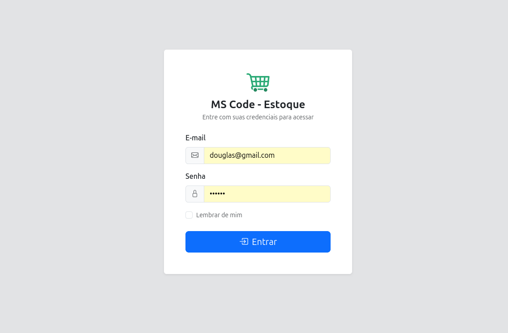
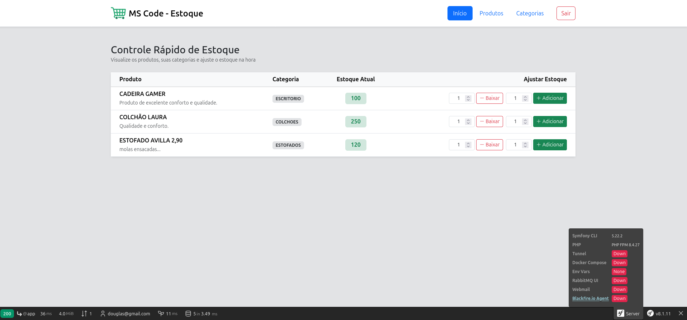
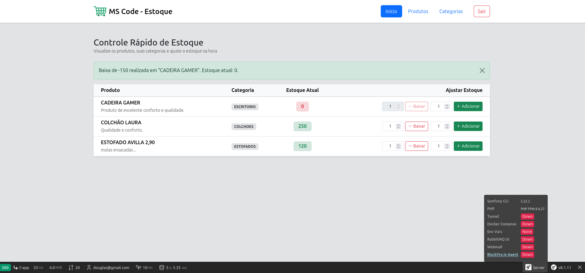
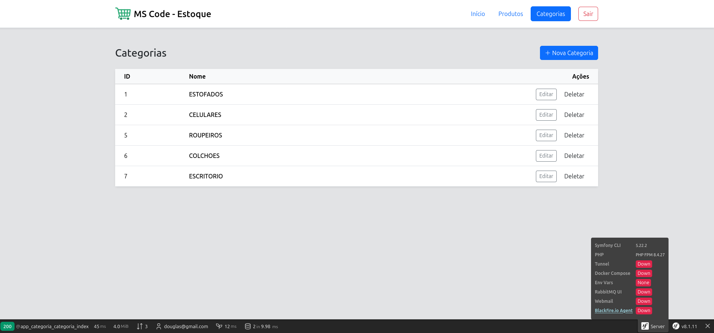
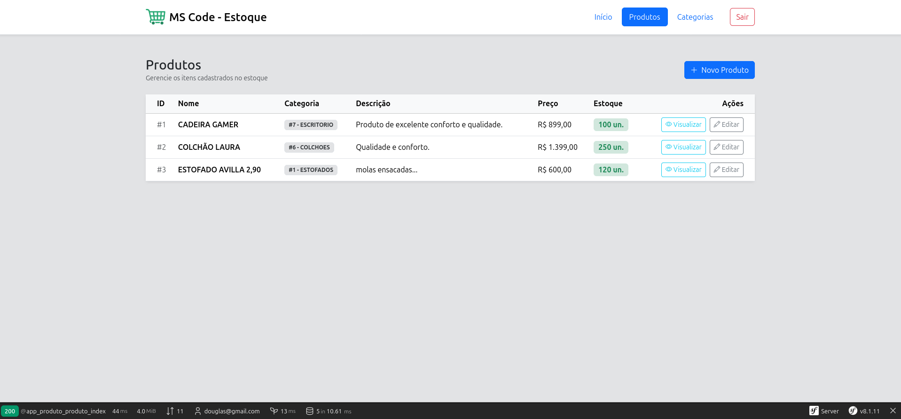
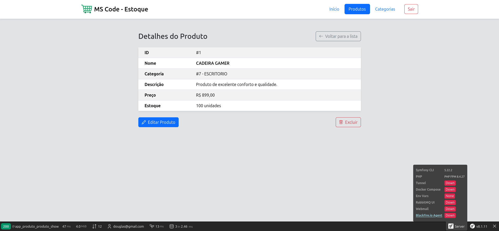

# MS Code - Estoque

Sistema de controle de estoque desenvolvido em **PHP / Symfony** com interface em **Twig** e **Bootstrap 5**.

## Telas do Sistema

### Tela de Login

### Controle Rápido de Estoque (Início)

### Categorias

### Produtos

